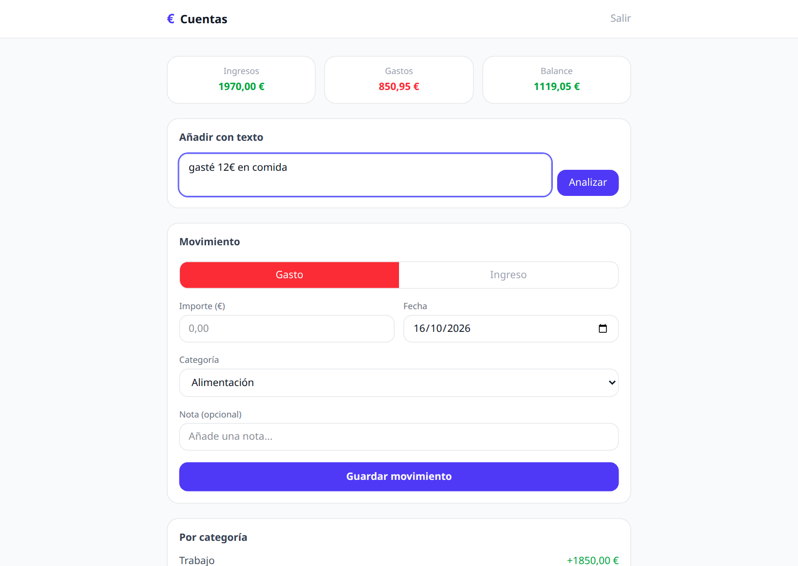
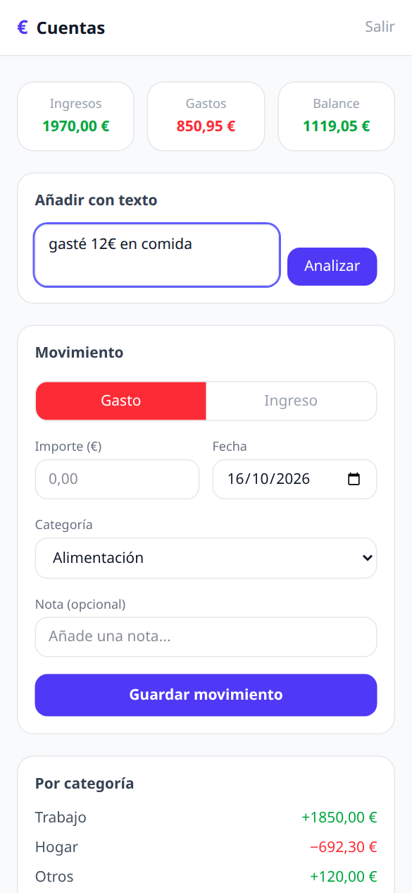

# Cuentas

App full-stack para llevar ingresos y gastos personales desde el móvil o el ordenador. Además del formulario clásico, permite apuntar un movimiento escribiendo en lenguaje natural ("gasté 12 € en comida"): la API lo interpreta con Gemini y precarga el formulario para confirmarlo.

<p>
  
  
</p>

## Funcionalidades

- Registro e inicio de sesión con JWT; cada usuario solo ve sus movimientos.
- Resumen de ingresos, gastos y balance, y desglose por categoría.
- Alta de movimientos manual o a partir de texto libre interpretado por IA.
- La respuesta del modelo se valida y normaliza antes de llegar al cliente (categoría permitida, importe positivo, fecha válida).
- PWA instalable en el móvil.

## Stack

| Capa | Tecnología |
|---|---|
| Monorepo | Turborepo + pnpm workspaces |
| Frontend | Next.js 15 (App Router, React 19), Tailwind CSS v4 |
| Backend | NestJS 11, TypeORM, class-validator, Passport JWT |
| Base de datos | PostgreSQL 16 (Docker en local) |
| IA | Google Gemini (`@google/genai`) |
| Tests / CI | Vitest, GitHub Actions |

## Estructura

```
apps/
  api/        API REST NestJS (auth, movimientos, parseo con IA)
  web/        Frontend Next.js
packages/
  types/      Tipos compartidos entre front y back (@cuentas/types)
```

El paquete `@cuentas/types` define el contrato entre frontend y backend: si cambia un tipo, el typecheck falla en los dos lados.

## Arrancar en local

Requisitos: Node 20+, pnpm 9+ y Docker.

```bash
cp apps/api/.env.example apps/api/.env      # añade tu GEMINI_API_KEY
cp apps/web/.env.example apps/web/.env
docker compose up -d                        # Postgres en localhost:5433
pnpm install
pnpm dev                                    # API en :3001/api, web en :3000
```

Sin `GEMINI_API_KEY` todo funciona salvo el alta por texto, que devuelve un error controlado.

### Variables de entorno de la API

| Variable | Descripción |
|---|---|
| `DATABASE_URL` | Conexión a PostgreSQL (obligatoria) |
| `JWT_SECRET` | Secreto para firmar los tokens (obligatoria) |
| `GEMINI_API_KEY` | Clave de Google AI Studio |
| `GEMINI_MODEL` | Modelo a usar (por defecto `gemini-2.5-flash`) |
| `APP_TIMEZONE` | Zona horaria para la fecha por defecto (por defecto `Europe/Madrid`) |
| `WEB_ORIGIN` | Origen permitido por CORS |
| `PORT` | Puerto de la API (por defecto `3001`) |

## API

Todas las rutas llevan el prefijo `/api`. Las de movimientos requieren `Authorization: Bearer <token>`.

| Método | Ruta | Descripción |
|---|---|---|
| `POST` | `/auth/register` | Crea un usuario y devuelve un token |
| `POST` | `/auth/login` | Devuelve un token |
| `GET` | `/transactions` | Movimientos del usuario, por fecha descendente |
| `GET` | `/transactions/summary` | Ingresos, gastos, balance y desglose por categoría |
| `POST` | `/transactions` | Crea un movimiento |
| `POST` | `/transactions/parse` | Interpreta un texto libre; no guarda nada |
| `DELETE` | `/transactions/:id` | Borra un movimiento propio |

## Scripts

```bash
pnpm test        # tests unitarios
pnpm typecheck   # TypeScript en todo el monorepo
pnpm build       # build de producción
```

## Limitaciones conocidas

- TypeORM usa `synchronize` en lugar de migraciones.
- El token se guarda en `localStorage` y no hay refresh tokens.
- El parseo por texto extrae un único movimiento por frase.
- Una sola moneda (EUR) y categorías fijas.
